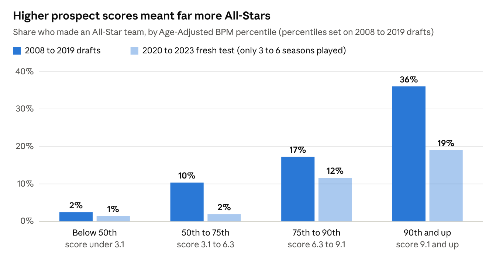
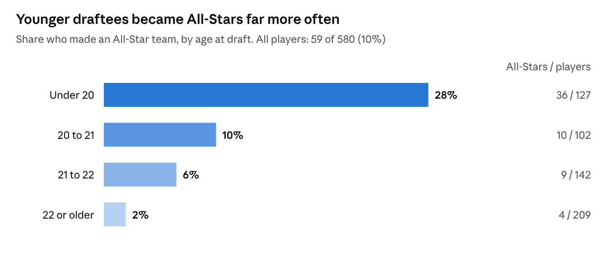
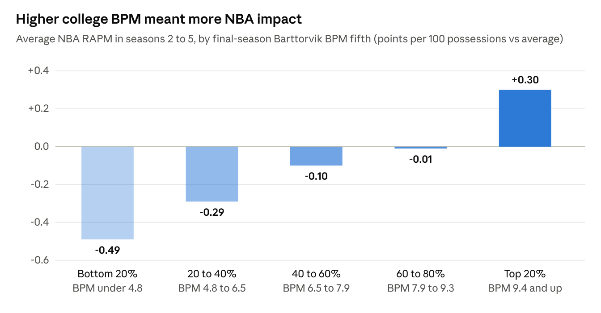
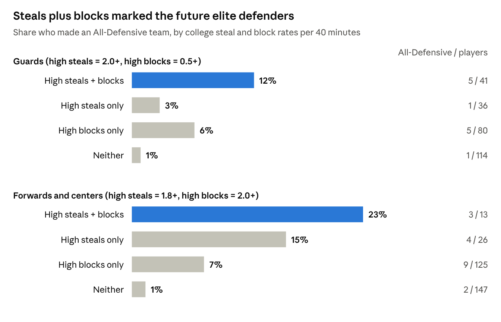
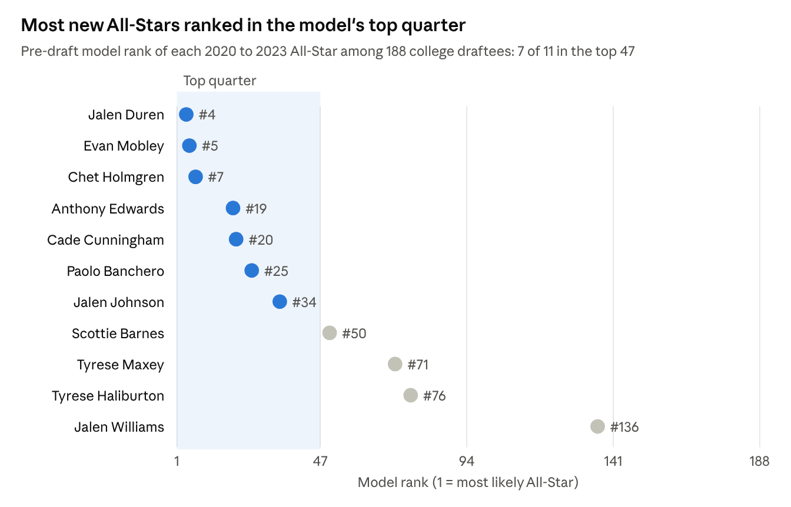
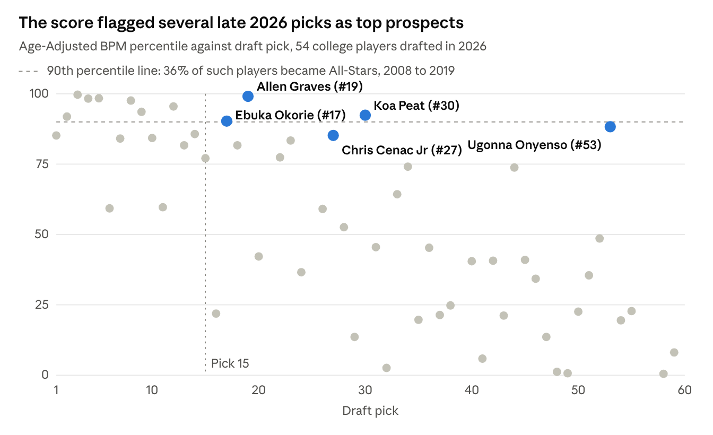

# What Predicts NBA Success Before the Draft

Which college numbers, known before draft night, point to NBA stardom and impact?
This project collects every college player drafted from 2002 to 2019 (816 players),
tests hundreds of college stats against what happened in their NBA careers, and
validates the results on an earlier era and on the 2020 to 2023 draft classes.

## The headline: one number

```
Prospect Score = college BPM + 3 x (20 - age at draft)
```

Each year younger than 20 on draft night is worth about 3 points of college BPM
(the data puts it at 3.2 across 2002 to 2019).



| Prospect score percentile | Became All-Stars, 2002 to 2019 |
| --- | --- |
| 90th and up | 32% |
| 75th to 90th | 23% |
| 50th to 75th | 10% |
| Below 50th | 3% |

- **Out-of-sample:** trained on 2008 to 2019, it ranked future All-Stars above non-All-Stars
  80% of the time (AUC 0.80) on the 2020 to 2023 classes, and 83% on the 2002 to 2007 classes.
  None of the 11 All-Stars drafted 2020 to 2023 scored below the 50th percentile.
- **Impact, not just awards:** college BPM was the best of 216 college stats screened for predicting NBA RAPM in
  seasons 2 to 5, with college offense predicting NBA offense and college defense predicting
  NBA defense. Age did not predict RAPM.
- **Defense:** college steal rate predicted All-Defensive selection in both eras, and still did
  after accounting for wingspan from the NBA Draft Combine.
- **What didn't help:** combine athletic testing, shot profile, recruiting rank and height added
  nothing once age and production were known.

## Charts







## Pipeline

Run the scripts in order from this folder. Each one caches what it downloads, so if one
stops partway, run it again and it picks up where it left off.

| Step | Script | What it does | Time |
| --- | --- | --- | --- |
| 1 | `allstar_step1.py` | 2008-2019 draft lists and award pages (Basketball Reference) | 3 min |
| 2 | `allstar_step2_player_pages.py` | All-Star, All-NBA and All-Defensive selections from each player's page | 35 min |
| 3 | `allstar_step3_college_stats.py` | Every college stats table, every season (Sports Reference) | 35 min |
| 3b | `allstar_step3b_fix_ages.py` | Birth dates and age at draft | seconds |
| 4 | `allstar_step4_model.py` | LASSO screening of 100 to 230 stats per outcome, cross validated | 10 min |
| 5 | `allstar_step5_robustness.py` | Position controls, permutation tests, bootstrap for the defense finding | 15 min |
| 6 | `allstar_step6_barttorvik_download.py` | Barttorvik seasons 2008-2019 | 1 min |
| 7 | `allstar_step7_new_classes.py` | 2020-2023 draft classes and Barttorvik 2020-2023 | 12 min |
| 8 | `allstar_step8_combine.py` | NBA Draft Combine measurements and drills, 2000-2023 (uses `nba_api`) | 2 min |
| 9 | `allstar_step9_older_classes.py` | 2002-2007 draft classes for the era check | 40 min |
| 10 | `allstar_step10_recent_classes.py` | Barttorvik seasons 2024-2026 | 1 min |
| 11 | `allstar_step11_barttorvik_features.py` | Matches players to Barttorvik and builds model inputs | seconds |
| 12 | `allstar_step12_prospect_score.py` | The prospect score, percentile table and fresh test | 1 min |
| 13 | `allstar_step13_rapm.py` | NBA RAPM analysis (downloads RAPM data) | 1 min |
| 14 | `allstar_step14_combine_analysis.py` | Do combine measurements add anything? | seconds |
| 15 | `allstar_step15_era_check.py` | 2002-2007 out-of-era test and 2002-2019 refit | 1 min |
| 16 | `allstar_step16_live_scores.py` | Prospect scores for the 2024, 2025 and 2026 drafts | seconds |

`allstar_common.py` holds shared helpers for steps 11 to 16.

### Setup

```
python -m pip install -r requirements.txt
```

### Outputs

Reports and tables land in `results/`. The `results/` folder in this repo holds the
outputs of steps 11 to 16, including `prospect_scores_2024_2026.csv`, the dated
predictions for the three most recent draft classes.

## Methods in brief

- **Outcomes:** ever selected All-Star, All-NBA or All-Defensive through 2025-26;
  NBA RAPM averaged over seasons 2 to 5.
- **Screening:** LASSO logistic regression with repeated stratified cross validation;
  duplicate stats (the same number stored in two tables) removed.
- **Multiple testing:** max-statistic permutation tests (2,000 shuffles) and Holm correction.
- **Validation:** a fresh test on 2020-2023 draftees, an out-of-era test on 2002-2007
  draftees, and a refit on all 2002-2019 players that reproduced the age weight.
- **Things that did not hold up, reported anyway:** free throws per 40 predicted stardom in
  2008-2019 but not in 2002-2007; LASSO selection frequency alone proved unreliable in
  shuffled-label tests, so it was used only for screening.

## Limitations

- Drafted college players only. Undrafted players, internationals and players from the
  G League or overseas are not covered.
- About 86 All-Stars in the 2002-2019 sample, so tier percentages are approximate.
- All-Star and All-Defensive selections are votes; RAPM is included as a check on real impact.
- Advanced college stats begin in 2008 (Barttorvik) and 2011 (Sports Reference); the
  2002-2007 era check uses a box-score estimate instead.
- The RAPM source repository may add seasons over time, which can shift those results slightly.

## Data sources

[Basketball Reference](https://www.basketball-reference.com),
[Sports Reference College Basketball](https://www.sports-reference.com/cbb/),
[Barttorvik](https://barttorvik.com),
[NBA.com Draft Combine](https://www.nba.com/stats/draft/combine) via
[nba_api](https://github.com/swar/nba_api), and NBA RAPM compiled in
[gabriel1200/site_Data](https://github.com/gabriel1200/site_Data).

The scraped data itself is not included in this repository; the scripts rebuild it.
Please respect each site's terms of use and rate limits (the scrapers wait between requests).
